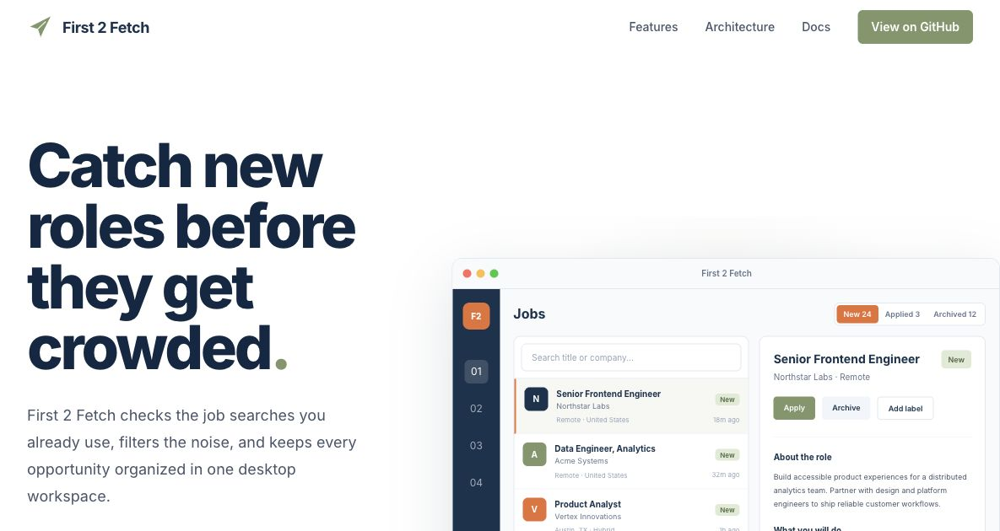
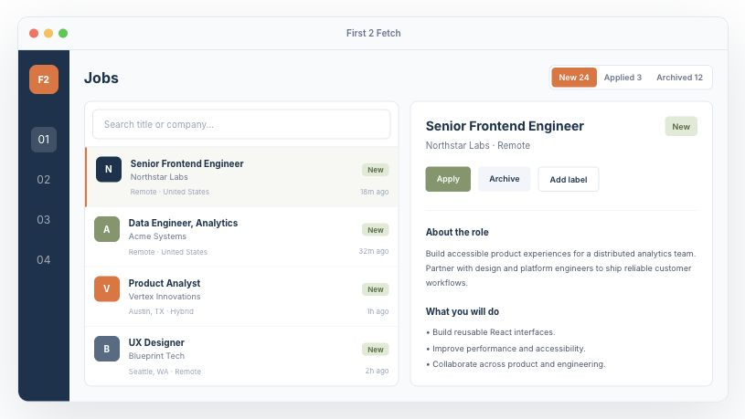
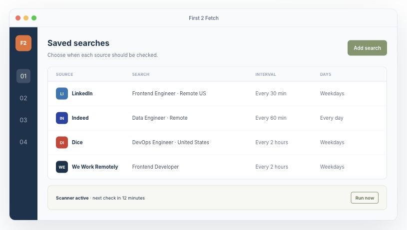
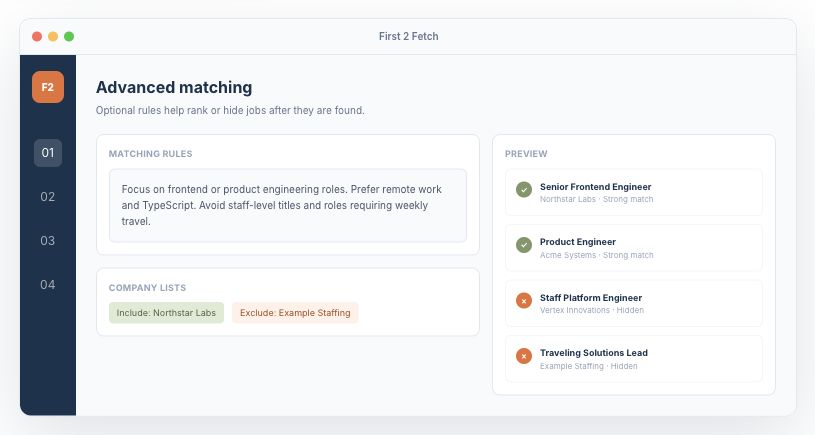
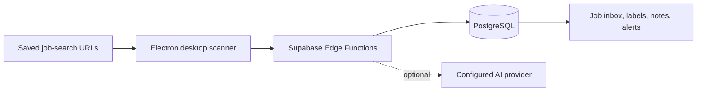

<div align="center">

# First 2 Fetch

**Monitor job searches, filter new listings, and organize every opportunity from one desktop app.**

[Website](https://i0x1.github.io/First2Fetch/) · [Quick start](#quick-start) · [Architecture](docs/architecture.md) · [Contributing](CONTRIBUTING.md)

[](https://github.com/i0x1/First2Fetch/actions/workflows/build-all-projects.yml)
[](LICENSE.txt)
[](https://www.typescriptlang.org/)
[](https://www.electronjs.org/)

</div>



First 2 Fetch turns saved job-board searches into a focused workflow. The Electron app checks search URLs on a schedule, sends structured results to a Supabase backend, optionally applies AI matching rules, and keeps new, applied, archived, and filtered jobs organized.

> All screenshots in this repository use fictional demonstration data. No real user profile, email, resume, search history, or API credential is shown.

## Features

### One Focused Job Inbox

Search and review jobs from multiple sources, open the full description, add notes and labels, then track each
opportunity through new, applied, archived, or filtered states.



### Flexible Saved Searches

Set a separate schedule for every source, see scanner status, and run an immediate check when needed.



### Optional Advanced Matching

Use normal filters, company include/exclude lists, or configurable AI rules to rank relevant roles and hide noise.



- Multi-source monitoring for LinkedIn, Indeed, Dice, Glassdoor, Hiring Cafe, Built In, Remote OK, Remotive, We Work Remotely, USAJobs, and additional sources
- Local Electron browser sessions for loading and scanning saved searches
- Date-grouped job inbox with search, labels, notes, status tracking, and bulk actions
- Configurable scan intervals, pause/resume controls, failure visibility, and desktop/email alerts
- Optional AI-assisted parsing and advanced matching with configurable providers
- Supabase authentication, PostgreSQL storage, Row Level Security, migrations, and edge functions
- Windows, macOS, and Linux packaging through Electron Forge

## How It Works



Browser sessions and page scanning run on the user’s computer. Supabase handles accounts, saved searches, structured job data, database security, and server-side workflows. Optional AI providers receive only the content needed for enabled parsing or matching features.

See [docs/architecture.md](docs/architecture.md) for the complete runtime and data-flow guide.

## Daily operation

Use the existing hosted Supabase project for both Electron and the web companion. Docker and local Supabase are not needed for normal use. Keep the desktop app on your computer for scanning; the web companion uses the same hosted jobs and workspace.

The local macOS app is installed in Applications. Open **First 2 Fetch** from Applications or the Dock for daily use; no Terminal command is needed. To install later code changes on this Mac, double-click **Update First2Fetch.command** in this repository. It checks for a clean checkout, fetches the pushed branch, builds and verifies a replacement, and then reopens the app. A web deployment does not update the desktop scanner.

This local app has an ad hoc signature and does not auto update. A signed macOS release would need an Apple Developer membership, a Developer ID Application certificate, and notarization credentials. Once available, download the Apple Silicon or Intel DMG from this repository's GitHub Releases page; signed releases check for desktop updates on startup and each hour.

Until the first signed release is published, double-click **Start First2Fetch.command** in this repository. Alternatively, open a normal macOS Terminal at the repository root and run:

```bash
pnpm --filter first2fetch-desktop start
```

Keep that Terminal window open while using the development app. Quit from the app menu, or press `Ctrl+C` in its Terminal. To reopen it, use the same launcher. Start one instance at a time.

The launcher uses `apps/desktopProbe/.env`. This file must contain the application bundle ID, hosted Supabase URL, and a public publishable or anon key. It is ignored by Git. A desktop package embeds the hosted URL and public key at build time. A separate working copy must reuse or receive this configuration before it is built; cloning the repository does not copy `.env` or your saved login.

Electron restores a valid session from its OS-encrypted local storage. If Supabase revokes or expires that session, sign in again. Keep the same environment and application identity to reuse the same session. Scanning retains its saved paused/running setting; check that setting before resuming scans.

When an agent launches Electron, allow the process to access the macOS desktop outside its command sandbox. In the 2026-10-16 test, sandboxed startup caused an AppKit registration crash (`SIGABRT`) and file-watcher errors (`EMFILE`). Running from a normal Terminal resolved both. A package built without `APP_BUNDLE_ID` also failed to initialize its API handlers. Do not use an incomplete test package as the normal launcher.

The release workflow requires an Apple Developer ID Application certificate and Apple notarization credentials. It stops before publishing if they are missing. See [docs/macos-release.md](docs/macos-release.md) for the release steps and update test.

For occasional job analysis, use the separate job and activity queries in [docs/jd-analytics-export.sql](docs/jd-analytics-export.sql) in the hosted Supabase SQL Editor. Each job description stays in its existing job row; an export does not require an analytics database or an import tool.

## Quick Start

### Prerequisites

- Node.js 22
- pnpm 10
- Access to the existing hosted Supabase project
- Supabase CLI for backend maintenance; Docker only for container builds or optional isolated tests

### 1. Install

```bash
git clone https://github.com/i0x1/First2Fetch.git
cd First2Fetch
pnpm install
pnpm --filter @first2apply/core build
pnpm --filter @first2apply/ui build
```

The internal `@first2apply/*` package names are retained for compatibility with the upstream project.

### 2. Configure the hosted Supabase project

```bash
cp apps/desktopProbe/.env.example apps/desktopProbe/.env
```

```dotenv
APP_BUNDLE_ID=ro.beastx.first2fetch.dev
SUPABASE_URL=https://your-project.supabase.co
SUPABASE_PUBLISHABLE_KEY=your_publishable_key
```

Use the existing project URL and its public publishable key from the Supabase dashboard. `SUPABASE_KEY` remains supported for an existing anon-key configuration. Never place a `service_role` key in the desktop app. Do not replace a working `.env` with the example.

### 3. Run the desktop app

For daily use while the app changes often, double-click `Start First2Fetch.command` in this folder. It starts Electron from the current source, so restart it after a code update to load that update. Keep the Terminal window open while the app runs; it shows startup errors and logs. The launcher selects Node.js 22 with nvm when available, checks the local setup, and enables polling to avoid macOS file watcher exhaustion.

The app in `/Applications` is a separate packaged copy. It does not receive source edits. Quit it before you start the development copy. Both copies share sign-in and settings, and only one can run at a time. For daily use, open only the development copy. Use `Update First2Fetch.command` when you want to rebuild and replace the packaged copy. A signed, notarized release with automatic updates needs an Apple Developer Program membership and release credentials.

```bash
pnpm --filter first2fetch-desktop start
```

Edge Functions run on hosted Supabase. See [web deployment preparation](apps/webapp/DEPLOYMENT.md) before changing hosted migrations or functions.

## Common Commands

```bash
pnpm build
pnpm lint
pnpm test
pnpm --filter first2fetch-desktop test
pnpm --filter @first2fetch/landing-page dev
```

The GitHub Pages site is available locally at `http://localhost:3000/First2Fetch/`.

## Repository Structure

| Path                     | Purpose                                                                   |
| ------------------------ | ------------------------------------------------------------------------- |
| `apps/desktopProbe`      | Electron app, React renderer, scanner, tray, notifications, and packaging |
| `apps/backend`           | Supabase migrations, seed data, and edge functions                        |
| `apps/landingPage`       | Static Next.js project website deployed to GitHub Pages                   |
| `apps/nodeBackend`       | Maintenance and migration utility                                         |
| `apps/invoiceDownloader` | Operational invoice utility inherited from upstream                       |
| `libraries/core`         | Shared types, provider config, errors, and logging                        |
| `libraries/ui`           | Shared Radix/Tailwind UI components                                       |
| `docs`                   | Architecture, operations, screenshots, and project notes                  |

## Configuration

Environment templates are included for the desktop app and Supabase edge functions. Real `.env` files, signing certificates, private keys, local exports, generated builds, and personal working notes are ignored by Git.

- Desktop variables: `apps/desktopProbe/.env.example`
- Edge-function variables: `apps/backend/supabase/functions/.env.example`
- Logging setup: [docs/logging.md](docs/logging.md)
- Security reporting: [SECURITY.md](SECURITY.md)

## Development Notes

- Run Supabase commands from `apps/backend`.
- Do not run `supabase db reset` against data you need to keep.
- Job-board HTML and login behavior change frequently; parser updates need tests and careful logging.
- Before publishing a release, verify all installers come from this repository’s release workflow.

## Contributing

Bug reports and focused pull requests are welcome. Read [CONTRIBUTING.md](CONTRIBUTING.md) before changing the database, parser behavior, IPC contracts, or shared types.

## License

First 2 Fetch is released under the [MIT License](LICENSE.txt).

## Fork Lineage

First 2 Fetch is a fork of [First 2 Apply](https://github.com/beastx-ro/first2apply) by BeastX Industries. It retains the core foundation while adding:

- Faster date-grouped job loading, database indexes, and timezone-aware queries
- Expanded job sources, custom sources, scanner controls, and failure visibility
- Advanced filtering, company lists, configurable AI providers, and task-specific AI models
- Improved job organization with labels, notes, bulk actions, CSV export, and job counts
- UX/UI decisions catering to larger job chunk 
- Broader API vendor support 
- etc.

The shared component library follows patterns from [shadcn/ui](https://ui.shadcn.com/) and uses [Radix UI](https://www.radix-ui.com/) primitives. Job-board names and logos belong to their respective owners.
